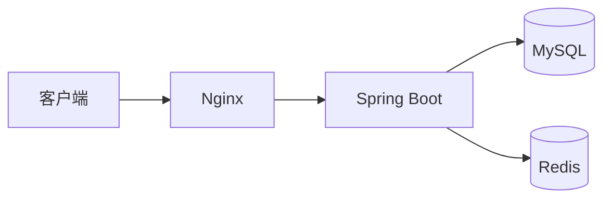

# 笔记规范

> 笔记不是抄书。判断一条笔记是否合格：**三个月后的你能靠它 5 分钟回忆起核心原理和代码写法。**

---

## 一、目录划分

| 目录 | 内容 |
|---|---|
| `00-工具与环境/` | JDK、Maven、IDEA、MySQL、Redis、Docker、Git、GitHub MCP 的安装配置与踩坑 |
| `01-Java基础/` | 语法、OOP、集合、泛型、Stream、IO、并发、JVM |
| `02-MySQL/` | SQL、索引、执行计划、事务、锁、优化、设计规范 |
| `03-Spring生态/` | IoC/AOP、Spring Boot、Spring MVC、MyBatis、Security、事务 |
| `04-中间件/` | Redis、RabbitMQ / Kafka、Elasticsearch |
| `05-前端Vue/` | HTML/CSS/JS、Vue3、Element Plus、Axios 封装 |
| `06-部署与运维/` | Linux、Docker、Nginx、CI/CD、云服务器 |
| `07-八股与面试/` | 专题八股、场景题、项目追问、面试复盘 |
| `templates/` | 模板，别改，复制出去用 |

---

## 二、命名规则

```
主题-细分.md
```

- 中文主题 + 英文技术名，用 `-` 连接，**不要有空格**
- 例：`MySQL-索引失效的8种场景.md`、`Redis-分布式锁的四种实现与坑.md`、`JWT-双Token刷新方案.md`
- 一个文件只讲一个主题；超过 300 行就拆
- 面试复盘特殊命名：`面试复盘-0415-某公司.md`

---

## 三、写笔记的正确姿势

1. **先写代码，再写笔记。** 没有可运行代码的笔记 = 抄写，不算数。
2. **先用自己的话写"是什么/为什么/怎么用"，再贴代码。** 顺序反了就变成代码仓库。
3. **必须有"我踩的坑"小节。** 这一节是面试时最有价值的部分。
4. **能用图就用图**：mermaid 画流程图/时序图（GitHub 原生渲染），比文字强十倍。
5. **每篇结尾写"面试怎么答"。** 一句话版本 + 展开版本。三个月后直接拿这个背。
6. **善用搜索**：写之前先在 `笔记/` 里搜一下，避免写出两篇重复的。

---

## 四、图片规范（**重要**）

❌ **不要**用 Typora/微信的默认绝对路径，例如：

```markdown

```

推到 GitHub 上 100% 裂图。

✅ **正确做法**：项目根目录建 `assets/`，按笔记名建子目录：

```
assets/MySQL-索引失效的8种场景/
├── 01-隐式转换.png
└── 02-函数索引用不上.png
```

引用时用**相对路径**（注意 `assets` 在仓库根，笔记在 `笔记/xx/` 下，所以是 `../../assets/`）：

```markdown

```

> **Typora 设置**：`文件 → 偏好设置 → 图像 → 插入图片时复制到指定路径`，路径填 `../../assets/${filename}/`，并勾选"优先使用相对路径"。这样以后贴图自动合规。
>
> 已经在 `笔记/mysql.md` 里的图片需要手工迁移一次。

能画成 mermaid 图就不要截图：



---

## 五、笔记模板

见 [`templates/笔记模板.md`](./templates/笔记模板.md)。复制到对应目录后改名使用。

---

## 六、当前待整理

- [ ] `笔记/mysql.md`：图片是绝对路径，需迁到 `assets/` 并改相对路径
- [ ] `笔记/mysql.md`：文件名不符合规范，建议拆分为 `MySQL-基础语法.md` + `MySQL-insert与约束.md`
