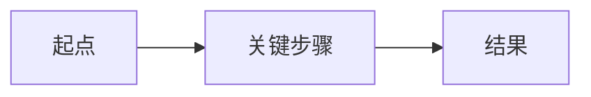

# <技术名>-<细分主题>

> 日期：2026-XX-XX ｜ 阶段：阶段X · 第X周 ｜ 标签：`#Java` `#集合`
>
> 一句话总结这篇笔记解决了什么问题：______

---

## 一、它是什么（用自己的话，禁止抄定义）

-

## 二、为什么需要它 / 解决什么问题

-

## 三、核心原理

<!-- 能用图就用 mermaid -->



关键点：

1.
2.

## 四、怎么用（可运行代码）

```java
// 最小可运行示例，不要伪代码
```

执行结果：

```
```

## 五、常见坑 / 我踩的坑

| 现象 | 原因 | 解决 |
|---|---|---|
|  |  |  |

## 六、和相似技术的对比 / 选型

| 方案 | 优点 | 缺点 | 适用场景 |
|---|---|---|---|
|  |  |  |  |

## 七、面试怎么答

- **一句话版**：
- **展开版（60 秒）**：
  1.
  2.
  3.
- **可能的追问**：
  - Q: → A:
  - Q: → A:

## 八、参考资料

- [官方文档]()

---
<!-- 检查清单：删掉本行前请自检 -->
<!-- [ ] 有自己的话，不是抄的  [ ] 有可运行代码  [ ] 有 mermaid 图或截图  [ ] 图片用相对路径  [ ] 有"面试怎么答" -->
