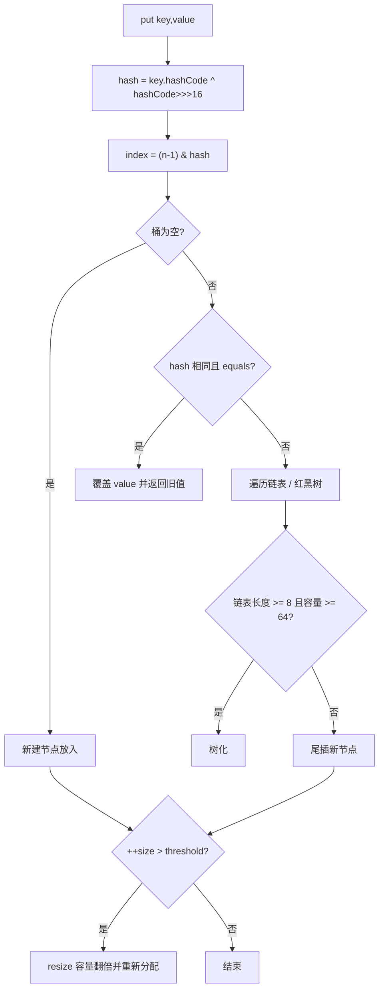

# W01D3 · 集合框架：手写一遍 ArrayList 与 HashMap

> 阶段一 · 第 1 周 · 星期三 ｜ 预计 4.5h ｜ 代码落点 `代码/stage1-javase/src/day03collections/`
>
> **今天是 W1 最重要的一天。** 手写一遍之后，`HashMap` 的面试题你会答得和别人不一样。

---

## 今日目标（≤ 3 条，必须可验证）

- [ ] 手写 `MyArrayList`，实现增删改查 + 1.5 倍扩容 + 迭代器，并通过越界与并发修改检查
- [ ] 手写 `MyHashMap`，实现数组+链表 + 扰动函数 + 2 倍扩容，**put 10 万条不崩**
- [ ] 笔记《集合-HashMap原理》含 mermaid 扩容流程图，能脱稿讲 3 分钟

## 一、学习要点

| 主题 | 要点 | 深度要求 |
|---|---|---|
| `ArrayList` | 底层 `Object[]`、默认容量 10 的**懒加载**、`grow()` 1.5 倍、`System.arraycopy`、`modCount` 与 fail-fast | **源码级** |
| `LinkedList` | 双向链表、头插尾插 O(1)、随机访问 O(n)、内存开销（每个节点多两个引用） | 会用 + 会对比 |
| `HashMap` | 数组+链表+红黑树、`hash()` 扰动、容量 2 的幂、`(n-1) & hash` 定位、负载因子 0.75、树化阈值 8 / 退化 6、扩容 2 倍与 rehash 的巧思 | **源码级** |
| 其他 Map | `LinkedHashMap`（accessOrder + LRU）、`TreeMap`（红黑树 + 排序）、`Hashtable`/`ConcurrentHashMap` 差异 | 会用 |
| `Iterator` | fail-fast 机制、为什么不能在 foreach 里 `remove`、`Iterator.remove()` 为什么可以 | **讲得清** |
| `equals`/`hashCode` | 再强调一次：HashMap 的 key 靠这两个方法定位 | 熟练 |

## 二、动手练习

### 第 1 步：`MyArrayList<T>`

```java
public class MyArrayList<T> implements Iterable<T> {
    private static final int DEFAULT_CAPACITY = 10;
    private Object[] elements;      // 注意：泛型数组不能直接 new T[]，所以用 Object[]
    private int size;
    private int modCount;           // 修改次数，用于 fail-fast

    public MyArrayList() { ... }                 // 懒加载：先给空数组
    public MyArrayList(int initialCapacity) { ... }

    public void add(T e) { ... }                 // 满了先扩容再放
    public void add(int index, T e) { ... }      // 需要 arraycopy 腾位置
    public T get(int index) { ... }              // 越界抛 IndexOutOfBoundsException，消息里带 index 和 size
    public T set(int index, T e) { ... }
    public T remove(int index) { ... }           // 返回被删元素，后面的前移，末尾置 null 帮助 GC
    public boolean remove(T e) { ... }
    public int size() { ... }
    public boolean isEmpty() { ... }
    public int indexOf(T e) { ... }
    public void clear() { ... }                  // 全部置 null

    private void grow() {
        int oldCap = elements.length;
        int newCap = oldCap + (oldCap >> 1);     // 1.5 倍，体会为什么用位运算
        // TODO: 边界（oldCap 为 0 时给 DEFAULT_CAPACITY）
        // TODO: Arrays.copyOf
    }

    @Override public Iterator<T> iterator() {
        return new Iterator<T>() {
            int cursor;
            int expectedModCount = modCount;
            @Override public boolean hasNext() { return cursor < size; }
            @SuppressWarnings("unchecked")
            @Override public T next() {
                if (modCount != expectedModCount) throw new ConcurrentModificationException("迭代中被修改");
                if (cursor >= size) throw new NoSuchElementException();
                return (T) elements[cursor++];
            }
            @Override public void remove() {
                if (modCount != expectedModCount) throw new ConcurrentModificationException();
                MyArrayList.this.remove(--cursor);
                expectedModCount = modCount;      // 关键：自己删的要同步
            }
        };
    }
}
```

**必须做的对照实验**（写进笔记）：
```java
// 实验 1：fail-fast
MyArrayList<String> list = new MyArrayList<>();
list.add("a"); list.add("b");
for (String s : list) { list.remove(s); }        // 期望抛 ConcurrentModificationException
// 换成用迭代器删，为什么不抛？

// 实验 2：扩容轨迹
MyArrayList<Integer> big = new MyArrayList<>();
for (int i = 0; i < 20; i++) { big.add(i); }     // 在 grow() 里打印每次扩容前后的容量
// 期望看到：0→10→15→22
```

### 第 2 步：`MyHashMap<K, V>`

```java
public class MyHashMap<K, V> {
    static class Node<K, V> {
        final int hash; final K key; V value; Node<K, V> next;
        Node(int hash, K key, V value, Node<K, V> next) { ... }
        @Override public String toString() { return key + "=" + value; }
    }

    private Node<K, V>[] table;
    private int size;
    private int threshold;                       // 容量 * 负载因子
    private static final float LOAD_FACTOR = 0.75f;
    private static final int DEFAULT_CAPACITY = 16;

    // ★ 扰动函数：让高位也参与运算，减少碰撞
    static int hash(Object key) {
        int h;
        return (key == null) ? 0 : (h = key.hashCode()) ^ (h >>> 16);
    }

    public V put(K key, V value) {
        // 1) 懒初始化 table
        // 2) 用 (n - 1) & hash 定位桶 —— 这就是为什么容量必须是 2 的幂
        // 3) 桶空 → 直接放；桶非空 → 遍历链表，key 相同则覆盖并返回旧值，否则尾插
        // 4) ++size > threshold → resize()
    }

    public V get(Object key) {
        // 定位桶 → 遍历链表 → 用 hash 相等 && (key == k || key.equals(k)) 比较
        // 注意：先比 hash 再比 equals，顺序不能反（equals 可能很贵）
    }

    public V remove(Object key) { ... }          // 链表删除，注意头节点特判

    private void resize() {
        // 容量翻倍
        // 重新分配每个节点 —— 先写一个「重新计算下标」的朴素版本
        // 再思考 JDK 的优化：因为容量是 2 的幂，节点要么留在原位 i，要么去 i + oldCap
        //   （依据是 hash & oldCap 这一位是 0 还是 1）
    }

    public int size() { ... }
    public boolean containsKey(Object key) { ... }
}
```

**必做的三个验证**（写进笔记）：

```java
// 验证 1：能存 10 万条且能全部取回
MyHashMap<Integer, String> map = new MyHashMap<>();
for (int i = 0; i < 100_000; i++) map.put(i, "v" + i);
System.out.println(map.size());                       // 100000
System.out.println(map.get(99_999));                  // v99999

// 验证 2：key 为 null 不崩（hash 返回 0）
map.put(null, "nullValue");
System.out.println(map.get(null));

// 验证 3：哈希碰撞 + 重复 key 覆盖
MyHashMap<String, Integer> m2 = new MyHashMap<>();
m2.put("a", 1); m2.put("a", 2);
System.out.println(m2.size());                        // 1
System.out.println(m2.get("a"));                      // 2
```
再在 `resize()` 里打印 `旧容量 -> 新容量`，观察 16 → 32 → 64 … 的轨迹。

### 第 3 步：看一遍 JDK 源码，和自己的对比

在 IDEA 里 `Ctrl+B` 进 `java.util.HashMap`，重点看四处并写进笔记：

| 位置 | 看什么 |
|---|---|
| `static final int hash(Object key)` | 扰动函数与你的实现是否一致 |
| `putVal()` | 桶为空的判断、链表尾插、树化条件 `++binCount >= TREEIFY_THRESHOLD - 1` |
| `resize()` | 高低位链表拆分的优化（`(e.hash & oldCap) == 0`） |
| `treeifyBin()` | 树化还要检查 `table.length >= MIN_TREEIFY_CAPACITY(64)`，否则先扩容 |

**写进笔记的一句话**：为什么负载因子是 0.75？（空间与时间的折中：太小浪费空间、频繁扩容；太大碰撞概率上升，查询退化成链表）

### 第 4 步：`LinkedHashMap` 做 LRU（10 行以内）

```java
public class LruCache<K, V> extends LinkedHashMap<K, V> {
    private final int capacity;
    public LruCache(int capacity) {
        super(capacity, 0.75f, true);   // ★ accessOrder = true 是精髓
        this.capacity = capacity;
    }
    @Override protected boolean removeEldestEntry(Map.Entry<K, V> eldest) {
        return size() > capacity;
    }
    public static void main(String[] args) {
        LruCache<Integer, String> cache = new LruCache<>(3);
        cache.put(1, "a"); cache.put(2, "b"); cache.put(3, "c");
        cache.get(1);                  // 访问 1，让 1 变成最近使用
        cache.put(4, "d");             // 淘汰最久未使用的 2
        System.out.println(cache.keySet());   // 期望 [3, 1, 4]
    }
}
```

## 三、产出路径

| 类型 | 路径 |
|---|---|
| 代码 | `代码/stage1-javase/src/day03collections/`（`MyArrayList` `MyHashMap` `LruCache` `Main` `CollectionCompare`） |
| 笔记 | `笔记/01-Java基础/集合-HashMap原理.md`（含 mermaid 扩容流程图 + JDK 源码对照表） |
| 笔记 | `笔记/01-Java基础/集合-ArrayList与LinkedList对比.md` |

mermaid 流程示例（写笔记时参考）：


## 四、验收标准（DoD）

- [ ] `MyArrayList` 扩容轨迹实测为 `0→10→15→22`
- [ ] `MyArrayList` 在 foreach 中 `list.remove` 抛 `ConcurrentModificationException`，改用迭代器删则正常
- [ ] `MyHashMap` 存 10 万条、全部取回正确；`put(null, ...)` 不崩
- [ ] `MyHashMap.resize()` 有容量变化日志，且 `size` 与 `table` 分布合理
- [ ] `LruCache` 输出 `[3, 1, 4]`
- [ ] 笔记里有 **JDK 源码对照表**（至少 4 处，写清"我写的" vs "JDK 做的"差异）
- [ ] 笔记有 mermaid 扩容流程图
- [ ] `git commit`：`feat(w01d3): 手写 MyArrayList/MyHashMap + LRU，附 JDK 源码对照`

## 五、面试自检

1. `HashMap` 的 `put` 完整流程讲一遍（从 hash 计算到扩容）。
2. 为什么容量必须是 2 的幂？`(n-1) & hash` 和 `hash % n` 有什么区别？
3. 扰动函数 `h ^ (h >>> 16)` 解决什么问题？不做会怎样？
4. 为什么负载因子默认 0.75？树化阈值为什么是 8、退化阈值为什么是 6？
5. 为什么 `HashMap` 线程不安全？1.7 的头插为什么会死循环？1.8 改尾插后还有别的问题吗（数据覆盖）？
6. `ArrayList` 扩容为什么是 1.5 倍而不是 2 倍？
7. `foreach` 里 `remove` 为什么会抛异常？`Iterator.remove` 为什么可以？
8. `ConcurrentHashMap` 1.7 分段锁和 1.8 CAS+synchronized 的区别？

## 六、收工记录

- 完成度：__%
- 卡在哪：
- 明天第一件事：
