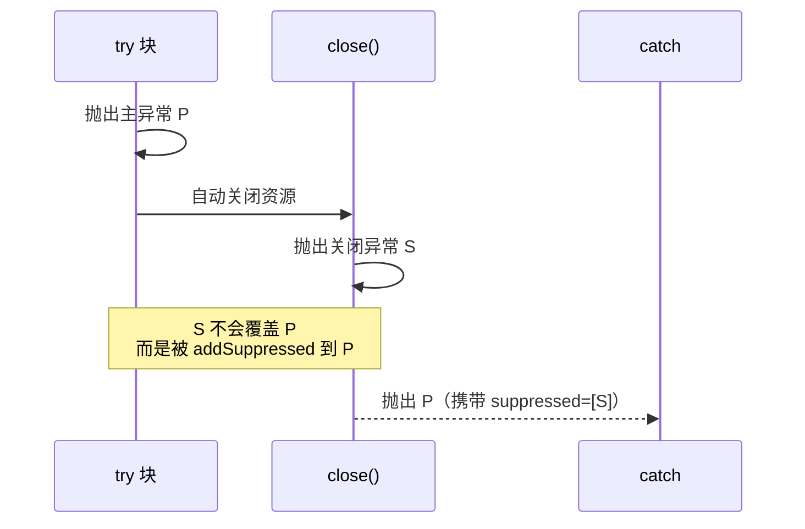

# W01D6 · 异常体系设计与资源管理

> 阶段一 · 第 1 周 · 星期六 ｜ 预计 4.5h ｜ 代码落点 `代码/stage1-javase/src/day06exception/`
>
> 今天的产出会**直接复用**到 W3 的图书管理系统、W6 的后台管理项目 —— 异常体系是工程骨架的一部分。

---

## 今日目标（≤ 3 条，必须可验证）

- [ ] 设计一套可复用的异常体系（`BusinessException` + 错误码枚举 + 3 个子类），并在 `Result<T>` 里用上
- [ ] 用实验证明 `try-with-resources` 的关闭顺序与**异常抑制**机制
- [ ] 笔记《异常设计规范》写清"什么时候抛、什么时候包装、什么时候记日志"

## 一、学习要点

| 主题 | 要点 | 深度要求 |
|---|---|---|
| 异常分类 | `Throwable` → `Error`（不该捕获）/ `Exception`；受检 vs 非受检（`RuntimeException`） | **讲得清** |
| 受检异常的代价 | 污染方法签名、`throws` 传染、lambda 里难用、影响 API 演进 | 能吐槽出理由 |
| 自定义异常 | 继承谁？为什么业务异常应该是**非受检**？错误码怎么带？ | **讲得清** |
| 异常包装 | `new XxxException(msg, cause)` —— **绝不要丢掉 cause** | 熟练 |
| `try-with-resources` | 自动关闭、**后开先关**、`getSuppressed()` 抑制异常、`AutoCloseable` vs `Closeable` | **源码级** |
| 反模式 | `catch (Exception e) {}` 空吞、`finally` 里 `return` 吞异常、用异常做流程控制、`printStackTrace` 当日志 | **能识别** |
| 日志规范 | 什么级别、什么该记、异常该记在哪一层、为什么不要既抛又记 | 会用 |

## 二、动手练习

### 第 1 步：错误码枚举（复用 D2 的 `ErrorCode`，做正式版）

```java
public enum ErrorCode {
    // 通用
    OK              ("00000", "成功"),
    SYSTEM_ERROR    ("B0001", "系统内部错误"),
    INVALID_PARAM   ("A0400", "请求参数校验失败"),
    UNAUTHORIZED    ("A0401", "未认证或登录已过期"),
    FORBIDDEN       ("A0403", "没有操作权限"),
    NOT_FOUND       ("A0404", "请求的资源不存在"),
    CONFLICT        ("A0409", "资源状态冲突"),
    TOO_MANY_REQUESTS("A0429", "请求过于频繁"),
    // 业务：通讯录（D7 会用到）
    CONTACT_NOT_FOUND("C1001", "联系人不存在"),
    CONTACT_DUPLICATE("C1002", "联系人已存在"),
    CONTACT_PHONE_INVALID("C1003", "手机号格式不正确");

    private final String code;
    private final String message;
    ErrorCode(String code, String message) { this.code = code; this.message = message; }
    public String code() { return code; }
    public String message() { return message; }
}
```

### 第 2 步：异常体系（三层结构）

```java
/** 所有业务异常的基类 —— 非受检，带错误码 */
public class BusinessException extends RuntimeException {
    private final ErrorCode errorCode;

    public BusinessException(ErrorCode errorCode) {
        super(errorCode.message());
        this.errorCode = errorCode;
    }
    public BusinessException(ErrorCode errorCode, String detail) {
        super(errorCode.message() + ": " + detail);
        this.errorCode = errorCode;
    }
    public BusinessException(ErrorCode errorCode, String detail, Throwable cause) {
        super(errorCode.message() + ": " + detail, cause);   // ★ 一定要传 cause
        this.errorCode = errorCode;
    }
    public ErrorCode getErrorCode() { return errorCode; }
}
```

三个子类，注意**构造器只留必要的**：

```java
// 参数非法
public class InvalidParameterException extends BusinessException {
    public InvalidParameterException(String detail) { super(ErrorCode.INVALID_PARAM, detail); }
}
// 资源不存在
public class ResourceNotFoundException extends BusinessException {
    public ResourceNotFoundException(String resource, Object id) {
        super(ErrorCode.NOT_FOUND, resource + " 不存在, id=" + id);
    }
}
// 资源冲突
public class DuplicateResourceException extends BusinessException {
    public DuplicateResourceException(String resource, String key) {
        super(ErrorCode.CONFLICT, resource + " 已存在: " + key);
    }
}
```

**设计问题（写进笔记）**：
1. 为什么业务异常继承 `RuntimeException` 而不是 `Exception`？
2. 子类还需要暴露 `getErrorCode()` 吗？（继承即可）
3. 如果错误码很多（100+），枚举要拆吗？怎么拆？（提示：按模块拆 `UserErrorCode`/`OrderErrorCode`，再抽接口）
4. 异常类要不要可序列化（`serialVersionUID`）？

### 第 3 步：`Result<T>` 与异常的桥接

在 D2 的 `Result` 上加：

```java
/** 把「可能抛业务异常」的代码块包成 Result —— 服务层边界用 */
public static <T> Result<T> of(Supplier<T> supplier) {
    try {
        return ok(supplier.get());
    } catch (BusinessException e) {
        return fail(e.getErrorCode().code(), e.getMessage());
    } catch (Exception e) {
        // 非业务异常：不吞，记日志 + 转成系统错误（但保留信息）
        log.error("系统异常", e);
        return fail(ErrorCode.SYSTEM_ERROR.code(), "系统繁忙，请稍后重试");
    }
}

/** 有返回值版本失败时直接抛，成功时给值 */
public T orElseThrow() {
    if (!success) throw new BusinessException(ErrorCode.SYSTEM_ERROR, message);
    return data;
}
```
在 `Main` 里写一段：
```java
Result<Integer> r = Result.of(() -> { throw new ResourceNotFoundException("联系人", 42); });
System.out.println(r);            // 期望：失败 + A0404 + "联系人 不存在, id=42"
```

### 第 4 步：`AutoCloseable` + 异常抑制实验（**今天最值钱的实验**）

```java
public class MyResource implements AutoCloseable {
    private final String name;
    private final boolean failOnClose;
    public MyResource(String name, boolean failOnClose) { this.name = name; this.failOnClose = failOnClose; }
    public void work() {
        System.out.println(name + ": 开始工作");
        if (name.equals("B")) throw new IllegalStateException("B 在工作时炸了");
    }
    @Override public void close() {
        System.out.println(name + ": 关闭");
        if (failOnClose) throw new IllegalStateException(name + " 关闭时也炸了");
    }
}
```

**实验 1：关闭顺序**
```java
try (MyResource a = new MyResource("A", false);
     MyResource b = new MyResource("B", false)) {
    a.work();
}
// 观察输出顺序：A 开始 → B 开始 → B 关闭 → A 关闭
// 结论：后开的先关（栈式）
```

**实验 2：业务异常 + 关闭异常 = 抑制异常**
```java
try {
    try (MyResource a = new MyResource("A", false);
         MyResource b = new MyResource("B", true)) {   // B 关闭时会抛
        a.work();                                      // B 的 work 先抛
    }
} catch (Exception e) {
    System.out.println("主异常: " + e.getMessage());
    for (Throwable s : e.getSuppressed()) {
        System.out.println("被抑制: " + s.getMessage());
    }
}
// 期望：主异常 = "B 在工作时炸了"，被抑制 = "B 关闭时也炸了"
// ★ 关键结论：主异常不会被 close 的异常覆盖，close 的异常进了 suppressed
```
把这个结论写成一句话：**`try-with-resources` 保证「原始异常不被关闭异常吞掉」** —— 这正是手写 `finally` 容易搞错的地方。

**实验 3：反例 —— `finally` 里的 `return` 吞异常**
```java
static int bad() {
    try {
        throw new RuntimeException("业务炸了");
    } finally {
        return 42;                 // ★ 异常被彻底吞掉，调用方拿到 42
    }
}
static int alsoBad() {
    try {
        throw new RuntimeException("业务炸了");
    } finally {
        throw new IllegalStateException("finally 的异常覆盖了原异常");   // ★ 原异常丢失
    }
}
```
两个都跑一遍，把现象和结论写进笔记。

### 第 5 步：受检异常转非受检的工具

```java
public final class Exceptions {
    /** 把受检异常包成非受检，保留 cause —— 在 lambda / Stream 里特别好用 */
    public static <T, R> Function<T, R> unchecked(ThrowingFunction<T, R> f) {
        return t -> {
            try { return f.apply(t); }
            catch (RuntimeException e) { throw e; }
            catch (Exception e) { throw new BusinessException(ErrorCode.SYSTEM_ERROR, "调用失败", e); }
        };
    }
    @FunctionalInterface
    public interface ThrowingFunction<T, R> { R apply(T t) throws Exception; }
}
```
用它解决一个真实痛点：
```java
List<Path> files = List.of(Path.of("a.txt"), Path.of("b.txt"));
// 下面这行直接写 Files::readString 会编译不过（受检异常）
List<String> contents = files.stream().map(Exceptions.unchecked(Files::readString)).toList();
```

### 第 6 步：日志规范（用 SLF4J，先加依赖或先只写规范）

W1 还没有 Maven，**今天只写规范，W2 装完 Maven 再换成真的 logback**。规范：

```java
// ❌ 全都不行
catch (Exception e) { }                              // 空吞
catch (Exception e) { e.printStackTrace(); }         // 打到 stderr，生产上抓不到
catch (Exception e) { System.out.println("出错了"); }  // 丢掉堆栈
catch (Exception e) { throw new RuntimeException("出错了"); }   // 丢 cause！
log.error("用户查询失败");                              // 没有堆栈，无法定位

// ✅ 正确
catch (Exception e) {
    log.error("查询用户失败, userId={}, 参数={}", userId, params, e);   // ★ 异常对象放最后一个参数
    throw new BusinessException(ErrorCode.SYSTEM_ERROR, "查询用户失败", e);
}

// ✅ 分层原则
// DAO 层    ：不捕获，直接往上抛（或包装成 DataAccessException）
// Service 层：业务异常直接抛；系统异常记日志 + 包装成 BusinessException
// Controller：统一异常处理器兜底（W4 学 @RestControllerAdvice）
// ★ 同一次异常只在一个地方记日志，否则日志里同一错误出现 3 次
```

## 三、产出路径

| 类型 | 路径 |
|---|---|
| 代码 | `代码/stage1-javase/src/day06exception/`（`ErrorCode` `BusinessException` + 3 子类 `Exceptions` `MyResource` `ExceptionLab` `Result`（迁移版）`Main`） |
| 笔记 | `笔记/01-Java基础/异常设计规范.md`（含抑制异常流程图） |
| 笔记 | `笔记/01-Java基础/异常-反模式清单.md` |

抑制异常 mermaid 参考：


## 四、验收标准（DoD）

- [ ] `BusinessException` 三层体系写完，3 个子类各有明确用途
- [ ] `Result.of(Supplier)` 能把业务异常转成失败结果，**系统异常不吞且保留 cause**
- [ ] 实验 1 输出顺序验证"后开先关"
- [ ] 实验 2 打印出主异常 + `getSuppressed()` 里的关闭异常
- [ ] 实验 3 两个反例都跑过，现象写进笔记
- [ ] `Exceptions.unchecked` 能解开"Stream 里用受检异常"的死结
- [ ] 笔记含「反模式清单」≥ 6 条，每条附错误/正确对照代码
- [ ] `git commit`：`feat(w01d6): 异常体系 + try-with-resources 抑制异常实验 + 日志规范`

## 五、面试自检

1. 受检异常和非受检异常怎么选？为什么 Spring 里几乎全是非受检异常？
2. 为什么包装异常时**必须**传 `cause`？不传会出现什么后果？
3. `try-with-resources` 的关闭顺序？如果 `try` 块和 `close()` 都抛异常，调用方拿到哪个？
4. 什么是抑制异常（suppressed）？为什么需要这个机制？
5. `finally` 里 `return` 或 `throw` 会发生什么？为什么 Java 允许这种写法却不推荐？
6. `throw` 和 `throws` 的区别？`Error` 该不该捕获？
7. 异常处理对性能有影响吗？`fillInStackTrace` 的开销在哪？（加分：为什么有的框架重写它）
8. 一个请求进来在 Service 抛异常，日志应该在哪一层打？为什么不能每层都打？

## 六、收工记录

- 完成度：__%
- 卡在哪：
- 明天第一件事：
