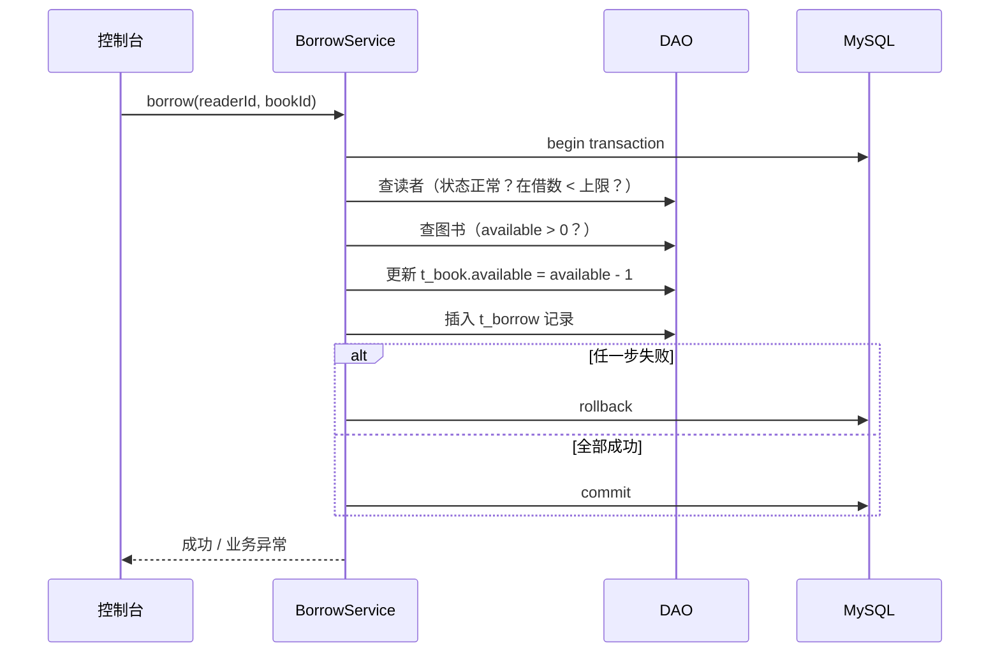

# 项目一 · 控制台图书管理系统

> 阶段一（第 3 周）｜技术栈：Java 17 + JDBC + MySQL 8 + HikariCP + JUnit 5 + Maven
>
> **目的**：在没有框架的情况下，手写一遍"分层 + 事务 + DAO"，理解框架帮你做了什么。

---

## 1. 项目简介

一个图书借阅管理的控制台程序，数据存 MySQL。不用 Spring，纯 Java + JDBC，通过命令行菜单操作。

**为什么做这个**：第 4 周开始就用 Spring Boot 了，如果没手写过 DAO 和事务，面试被问"`@Transactional` 底层做了什么"只能背答案。

## 2. 技术栈

| 组件 | 版本 | 用途 |
|---|---|---|
| JDK | 17 或 21 | 语言（LTS，别用 26 做项目基线） |
| Maven | 3.9+ | 构建与多模块 |
| MySQL | 8.0 | 持久化 |
| HikariCP | 5.x | 连接池 |
| JUnit 5 + Mockito | 5.10+ | 单元测试 |
| SLF4J + Logback | 2.x | 日志（**禁止用 System.out 打日志**） |

## 3. 角色与用例

| 角色 | 能做什么 |
|---|---|
| 图书管理员 | 图书 CRUD、读者 CRUD、办理借书/还书、查看统计 |
| 读者 | （本版本不做登录）被借阅记录关联 |

## 4. 功能清单

| 模块 | 功能 | 优先级 |
|---|---|---|
| 图书管理 | 新增 / 修改 / 删除（逻辑删除）/ 按 ID 查 / 多条件分页查（书名模糊、分类、状态） | P0 |
| 读者管理 | 新增 / 修改 / 禁用 / 查询 | P0 |
| 借阅管理 | 借书（校验库存与读者状态）/ 还书（计算逾期）/ 续借 / 借阅记录查询 | P0 |
| 统计报表 | 借阅排行榜 TopN、分类库存统计、逾期未还清单 | P1 |
| 系统 | 统一异常处理、操作日志、配置外置（`db.properties`） | P0 |

## 5. 数据库设计

```sql
CREATE DATABASE IF NOT EXISTS library_db DEFAULT CHARACTER SET utf8mb4 COLLATE utf8mb4_general_ci;

-- 图书分类
CREATE TABLE t_category (
  id          BIGINT       NOT NULL AUTO_INCREMENT COMMENT '主键',
  name        VARCHAR(50)  NOT NULL COMMENT '分类名',
  sort        INT          NOT NULL DEFAULT 0 COMMENT '排序',
  deleted     TINYINT      NOT NULL DEFAULT 0 COMMENT '逻辑删除 0否1是',
  create_time DATETIME     NOT NULL DEFAULT CURRENT_TIMESTAMP,
  update_time DATETIME     NOT NULL DEFAULT CURRENT_TIMESTAMP ON UPDATE CURRENT_TIMESTAMP,
  PRIMARY KEY (id),
  UNIQUE KEY uk_name (name)
) ENGINE=InnoDB COMMENT='图书分类';

-- 图书
CREATE TABLE t_book (
  id          BIGINT       NOT NULL AUTO_INCREMENT,
  isbn        VARCHAR(20)  NOT NULL COMMENT 'ISBN',
  title       VARCHAR(200) NOT NULL COMMENT '书名',
  author      VARCHAR(100) NOT NULL COMMENT '作者',
  publisher   VARCHAR(100)          COMMENT '出版社',
  category_id BIGINT       NOT NULL COMMENT '分类ID',
  price       DECIMAL(10,2) NOT NULL DEFAULT 0 COMMENT '定价',
  total       INT          NOT NULL DEFAULT 0 COMMENT '总库存',
  available   INT          NOT NULL DEFAULT 0 COMMENT '可借数量',
  status      TINYINT      NOT NULL DEFAULT 1 COMMENT '1可借 0下架',
  deleted     TINYINT      NOT NULL DEFAULT 0,
  create_time DATETIME     NOT NULL DEFAULT CURRENT_TIMESTAMP,
  update_time DATETIME     NOT NULL DEFAULT CURRENT_TIMESTAMP ON UPDATE CURRENT_TIMESTAMP,
  PRIMARY KEY (id),
  UNIQUE KEY uk_isbn (isbn),
  KEY idx_title (title),
  KEY idx_category (category_id),
  CONSTRAINT fk_book_category FOREIGN KEY (category_id) REFERENCES t_category(id)
) ENGINE=InnoDB COMMENT='图书';

-- 读者
CREATE TABLE t_reader (
  id          BIGINT      NOT NULL AUTO_INCREMENT,
  card_no     VARCHAR(20) NOT NULL COMMENT '借书证号',
  name        VARCHAR(50) NOT NULL,
  phone       VARCHAR(20)          COMMENT '手机号',
  max_borrow  INT         NOT NULL DEFAULT 5 COMMENT '最大可借数',
  status      TINYINT     NOT NULL DEFAULT 1 COMMENT '1正常 0禁用',
  deleted     TINYINT     NOT NULL DEFAULT 0,
  create_time DATETIME    NOT NULL DEFAULT CURRENT_TIMESTAMP,
  update_time DATETIME    NOT NULL DEFAULT CURRENT_TIMESTAMP ON UPDATE CURRENT_TIMESTAMP,
  PRIMARY KEY (id),
  UNIQUE KEY uk_card_no (card_no)
) ENGINE=InnoDB COMMENT='读者';

-- 借阅记录
CREATE TABLE t_borrow (
  id          BIGINT   NOT NULL AUTO_INCREMENT,
  reader_id   BIGINT   NOT NULL,
  book_id     BIGINT   NOT NULL,
  borrow_time DATETIME NOT NULL COMMENT '借出时间',
  due_time    DATETIME NOT NULL COMMENT '应还时间（借出+30天）',
  return_time DATETIME          COMMENT '实还时间，NULL 表示未还',
  renew_count INT      NOT NULL DEFAULT 0 COMMENT '续借次数，最多1次',
  status      TINYINT  NOT NULL DEFAULT 0 COMMENT '0借出中 1已归还 2逾期未还',
  fine        DECIMAL(10,2) NOT NULL DEFAULT 0 COMMENT '逾期罚金',
  create_time DATETIME NOT NULL DEFAULT CURRENT_TIMESTAMP,
  update_time DATETIME NOT NULL DEFAULT CURRENT_TIMESTAMP ON UPDATE CURRENT_TIMESTAMP,
  PRIMARY KEY (id),
  KEY idx_reader_status (reader_id, status),
  KEY idx_book (book_id),
  KEY idx_due (due_time)
) ENGINE=InnoDB COMMENT='借阅记录';
```

### 索引设计说明（面试会问）

| 索引 | 为什么建 |
|---|---|
| `uk_isbn` | ISBN 业务唯一，防重复录入 |
| `idx_title` | 书名模糊查询（前缀匹配可用索引） |
| `idx_reader_status (reader_id, status)` | 查"某读者当前在借"走联合索引，最左前缀 `reader_id` 也有用 |
| `idx_due` | 定时任务扫"今天到期的书"，范围查询 |
| `uk_card_no` | 借书证号唯一 |

## 6. 分层结构

```
src/main/java/com/gagahaolihai/library/
├── Main.java                 ← 菜单入口（只做输入输出，不写业务）
├── config/                   ← 数据源配置、读取 db.properties
├── entity/                   ← Book, Reader, Borrow, Category
├── dao/                      ← 接口：BookDao, ReaderDao, BorrowDao
│   └── impl/                 ← JdbcBookDao ...（只写 SQL，不写业务规则）
├── service/                  ← 接口 + impl（业务规则 + 事务边界）
├── exception/                ← BusinessException, DataAccessException
├── util/                     ← JdbcUtil, DateUtil, ConsoleUtil
└── vo/                       ← 统计结果对象（BorrowRankVO ...）
```

**架构纪律（会被 review）**
- `Main` 里不允许出现 SQL 和业务判断
- `dao` 里不允许出现"库存不足"这类业务规则
- `service` 是**事务边界**：一个业务方法一个事务

## 7. 核心流程

### 借书（必须在一个事务里）



### 还书
1. 查借阅记录（必须处于"借出中"）
2. 计算逾期天数与罚金（每天 0.2 元，封顶书价）
3. 更新记录状态与 `return_time`
4. 图书 `available + 1`
5. 同一事务提交

## 8. 接口清单（控制台菜单即"接口"）

| 编号 | 功能 | 输入 | 输出 | 异常场景 |
|---|---|---|---|---|
| 1.1 | 新增图书 | ISBN/书名/作者/分类/价格/数量 | 新书 ID | ISBN 重复、分类不存在 |
| 1.2 | 图书查询 | 关键字/分类/状态/页码 | 分页列表 | — |
| 2.1 | 办理借书 | 借书证号/ISBN | 借阅 ID + 应还日期 | 读者不存在/已禁用/超限、书无可借 |
| 2.2 | 办理还书 | 借书证号/ISBN | 罚金 | 无此借阅记录 |
| 2.3 | 续借 | 借阅 ID | 新应还日期 | 已逾期不可续借、已续借过 |
| 3.1 | 借阅排行 | TopN | 书名+次数 | — |
| 3.2 | 逾期清单 | — | 读者+书名+逾期天数+罚金 | — |

统一异常约定：业务异常 → 打印友好提示；系统异常 → 记日志（含堆栈）+ 提示"系统错误，请查看日志"。

## 9. 非功能需求

- **性能**：10 万条图书下，分页查询 < 200ms（用 `LIMIT` + 索引）
- **安全**：全部 `PreparedStatement`，禁止字符串拼 SQL；配置文件不提交密码（用 `.gitignore` 排除 `db.properties`，提供 `db.properties.example`）
- **可测试**：Service 层单测用 Mockito 打桩 DAO，不依赖真实数据库
- **代码量参考**：2000–3000 行（含测试）

## 10. 验收清单

- [ ] `schema.sql` + `data.sql` 能一键建库并插入 ≥ 50 本书、10 个读者
- [ ] `README.md` 三步启动（建库 → 复制 `db.properties.example` 填密码 → 运行 `Main`）
- [ ] 借书/还书在异常时完整回滚（有单测证明）
- [ ] ≥ 10 个单元测试，`mvn test` 全绿
- [ ] 无 `System.out` 调试信息残留，全部走日志
- [ ] 所有 SQL 参数化，无注入风险
- [ ] ≥ 15 次有意义的 commit，≥ 3 个已合并 PR
- [ ] `docs/` 下有表设计说明与索引说明
- [ ] 打 Tag `v1.0-stage1`，写 Release Note

## 11. 面试自问自答（写完项目必须能答）

1. 事务为什么放在 Service 层，不放在 DAO 层？
2. 两个用户同时借最后一本书，会发生什么？你怎么防？（提示：`UPDATE ... WHERE available > 0` 的原子性 / 乐观锁）
3. `PreparedStatement` 为什么能防 SQL 注入？
4. DAO 抽接口的意义是什么？只用一个实现类不是多余吗？
5. 连接池的作用？池子满了新请求会怎样？
6. 你为什么不直接用一个类写完，非得分层？（答：可维护性、可测试性、职责单一）
