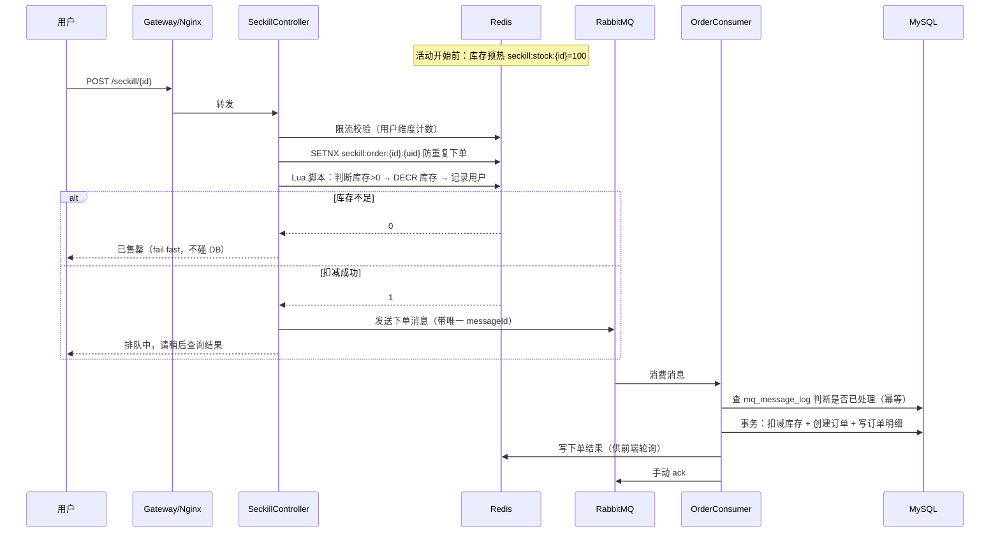
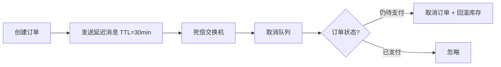

# 项目三 · 全栈电商系统（含秒杀）

> 阶段三（第 7–9 周）｜技术栈：Spring Boot 3.3 + MyBatis-Plus + MySQL 8 + Redis 7 + RabbitMQ + Spring Security + JWT + Vue 3 + Element Plus + Axios + Vite
>
> **目的**：这是**简历上的亮点项目**。前两个项目证明"你会写代码"，这个项目证明"你能处理复杂问题"（缓存、消息、并发、前后端联调）。
>
> **核心要求**：必须有**可量化的性能数据**。没有数字的"高并发"在面试官眼里等于没有。

---

## 1. 项目简介

一个前后端分离的电商系统，覆盖"浏览商品 → 加购 → 下单 → 支付（模拟）→ 订单管理"完整链路，并实现**秒杀**场景下的防超卖、限流、异步削峰。

前端用 Vue 3 + Element Plus 独立开发，与后端通过 REST API 交互。

## 2. 技术栈

| 层 | 技术 |
|---|---|
| 后端 | JDK 17 / Spring Boot 3.3 / MyBatis-Plus / Spring Security 6 / JWT / Spring Validation / SpringDoc |
| 存储 | MySQL 8（业务数据）+ Redis 7（缓存/库存/分布式锁/购物车/Token） |
| 消息 | RabbitMQ 3.x（异步下单、延迟队列取消订单） |
| 前端 | Vue 3 + Vite + Vue Router + Pinia + Element Plus + Axios + ECharts（可选） |
| 测试 | JUnit 5 + Mockito + JMeter（压测） |
| 部署 | Docker + docker-compose + Nginx（W10 完整做） |

## 3. 角色与用例

| 角色 | 用例 |
|---|---|
| 游客 | 浏览商品、搜索、查看详情 |
| 会员 | 注册登录、加购、下单、支付、查看订单、取消订单、收货地址管理 |
| 管理员 | 商品/分类管理、订单管理、用户管理（复用项目二 RBAC 骨架） |

## 4. 功能清单

| 模块 | 功能 | 优先级 | 技术点 |
|---|---|---|---|
| 用户 | 注册/登录/JWT 双 Token/无感刷新/个人中心 | P0 | Security + Redis |
| 商品 | 分类树、商品列表（多条件+分页）、详情（**缓存**）、搜索 | P0 | Redis 缓存、索引 |
| 购物车 | Redis Hash 存储、登录后合并匿名购物车、数量增减、选中结算 | P0 | Redis 数据结构选型 |
| 订单 | 创建订单（**Redis 预扣库存 + MQ 异步落库 + 幂等**）、订单列表/详情、取消（**延迟队列超时自动取消**）、状态机 | P0 | MQ、事务、幂等 |
| 秒杀 | 限流、防超卖、防重复下单、异步返回结果 | P0 | Lua 原子性、MQ 削峰 |
| 支付 | **模拟支付**：生成本地支付单 + 回调接口 + 签名校验 | P1 | 回调幂等 |
| 收货地址 | CRUD、默认地址 | P1 | — |
| 后台 | 商品/订单/用户管理页面 | P1 | 复用项目二 |
| 搜索 | 关键词搜索（先 MySQL `LIKE`/全文索引，ES 作为 W11 可选延伸） | P2 | — |

## 5. 数据库设计（核心表）

```sql
-- 用户（沿用项目二 sys_user，此处为独立电商用户表）
CREATE TABLE ums_user (
  id          BIGINT       NOT NULL AUTO_INCREMENT,
  username    VARCHAR(30)  NOT NULL,
  password    VARCHAR(100) NOT NULL COMMENT 'BCrypt',
  nickname    VARCHAR(30),
  phone       VARCHAR(11),
  avatar      VARCHAR(255),
  status      TINYINT      NOT NULL DEFAULT 1 COMMENT '1正常 0禁用',
  create_time DATETIME     DEFAULT CURRENT_TIMESTAMP,
  update_time DATETIME     DEFAULT CURRENT_TIMESTAMP ON UPDATE CURRENT_TIMESTAMP,
  PRIMARY KEY (id),
  UNIQUE KEY uk_username (username),
  UNIQUE KEY uk_phone (phone)
) ENGINE=InnoDB COMMENT='用户表';

-- 分类
CREATE TABLE pms_category (
  id        BIGINT      NOT NULL AUTO_INCREMENT,
  parent_id BIGINT      NOT NULL DEFAULT 0,
  name      VARCHAR(50) NOT NULL,
  level     TINYINT     NOT NULL DEFAULT 1,
  sort      INT         NOT NULL DEFAULT 0,
  status    TINYINT     NOT NULL DEFAULT 1,
  PRIMARY KEY (id),
  KEY idx_parent (parent_id)
) ENGINE=InnoDB COMMENT='商品分类';

-- 商品（SPU）
CREATE TABLE pms_product (
  id            BIGINT        NOT NULL AUTO_INCREMENT,
  category_id   BIGINT        NOT NULL,
  name          VARCHAR(200)  NOT NULL,
  subtitle      VARCHAR(255),
  main_image    VARCHAR(255),
  price         DECIMAL(10,2) NOT NULL,
  original_price DECIMAL(10,2),
  stock         INT           NOT NULL DEFAULT 0 COMMENT '总库存',
  sale          INT           NOT NULL DEFAULT 0 COMMENT '销量',
  status        TINYINT       NOT NULL DEFAULT 1 COMMENT '1上架 0下架',
  is_seckill    TINYINT       NOT NULL DEFAULT 0 COMMENT '是否秒杀商品',
  detail        TEXT,
  create_time   DATETIME      DEFAULT CURRENT_TIMESTAMP,
  update_time   DATETIME      DEFAULT CURRENT_TIMESTAMP ON UPDATE CURRENT_TIMESTAMP,
  PRIMARY KEY (id),
  KEY idx_category_status (category_id, status),
  KEY idx_name (name),
  KEY idx_price (price)
) ENGINE=InnoDB COMMENT='商品表';

-- 秒杀活动
CREATE TABLE sms_seckill (
  id             BIGINT        NOT NULL AUTO_INCREMENT,
  product_id     BIGINT        NOT NULL,
  seckill_price  DECIMAL(10,2) NOT NULL,
  seckill_stock  INT           NOT NULL COMMENT '秒杀库存',
  start_time     DATETIME      NOT NULL,
  end_time       DATETIME      NOT NULL,
  status         TINYINT       NOT NULL DEFAULT 0 COMMENT '0未开始 1进行中 2已结束',
  version        INT           NOT NULL DEFAULT 0 COMMENT '乐观锁',
  PRIMARY KEY (id),
  KEY idx_product (product_id),
  KEY idx_time (start_time, end_time)
) ENGINE=InnoDB COMMENT='秒杀活动';

-- 购物车（持久化兜底，主存 Redis）
CREATE TABLE oms_cart_item (
  id         BIGINT   NOT NULL AUTO_INCREMENT,
  user_id    BIGINT   NOT NULL,
  product_id BIGINT   NOT NULL,
  quantity   INT      NOT NULL DEFAULT 1,
  checked    TINYINT  NOT NULL DEFAULT 1,
  create_time DATETIME DEFAULT CURRENT_TIMESTAMP,
  update_time DATETIME DEFAULT CURRENT_TIMESTAMP ON UPDATE CURRENT_TIMESTAMP,
  PRIMARY KEY (id),
  UNIQUE KEY uk_user_product (user_id, product_id)
) ENGINE=InnoDB COMMENT='购物车';

-- 订单
CREATE TABLE oms_order (
  id            BIGINT        NOT NULL AUTO_INCREMENT,
  order_no      VARCHAR(32)   NOT NULL COMMENT '业务订单号（雪花或时间戳+随机）',
  user_id       BIGINT        NOT NULL,
  total_amount  DECIMAL(10,2) NOT NULL,
  pay_amount    DECIMAL(10,2) NOT NULL,
  status        TINYINT       NOT NULL DEFAULT 0 COMMENT '0待支付 1已支付 2已发货 3已完成 4已取消 5已退款',
  receiver_name VARCHAR(50),
  receiver_phone VARCHAR(20),
  receiver_address VARCHAR(255),
  pay_time      DATETIME,
  delivery_time DATETIME,
  note          VARCHAR(500),
  create_time   DATETIME      DEFAULT CURRENT_TIMESTAMP,
  update_time   DATETIME      DEFAULT CURRENT_TIMESTAMP ON UPDATE CURRENT_TIMESTAMP,
  PRIMARY KEY (id),
  UNIQUE KEY uk_order_no (order_no),
  KEY idx_user_status (user_id, status),
  KEY idx_create_time (create_time)
) ENGINE=InnoDB COMMENT='订单表';

-- 订单明细
CREATE TABLE oms_order_item (
  id            BIGINT        NOT NULL AUTO_INCREMENT,
  order_id      BIGINT        NOT NULL,
  order_no      VARCHAR(32)   NOT NULL,
  product_id    BIGINT        NOT NULL,
  product_name  VARCHAR(200)  NOT NULL COMMENT '冗余，防商品改名',
  product_image VARCHAR(255),
  price         DECIMAL(10,2) NOT NULL,
  quantity      INT           NOT NULL,
  total_amount  DECIMAL(10,2) NOT NULL,
  PRIMARY KEY (id),
  KEY idx_order (order_id),
  KEY idx_product (product_id)
) ENGINE=InnoDB COMMENT='订单明细';

-- 消息去重表（幂等消费）
CREATE TABLE mq_message_log (
  id          BIGINT       NOT NULL AUTO_INCREMENT,
  message_id  VARCHAR(64)  NOT NULL COMMENT '业务唯一消息ID',
  status      TINYINT      NOT NULL DEFAULT 0 COMMENT '0处理中 1成功 2失败',
  retry_count INT          NOT NULL DEFAULT 0,
  error_msg   VARCHAR(500),
  create_time DATETIME     DEFAULT CURRENT_TIMESTAMP,
  update_time DATETIME     DEFAULT CURRENT_TIMESTAMP ON UPDATE CURRENT_TIMESTAMP,
  PRIMARY KEY (id),
  UNIQUE KEY uk_message_id (message_id)
) ENGINE=InnoDB COMMENT='消息幂等日志';
```

### 设计要点（面试必答）

| 问题 | 要点 |
|---|---|
| 订单为什么冗余商品名和图片？ | 商品改名后历史订单要显示下单时的信息，属于**反范式**的合理使用 |
| 金额为什么用 `DECIMAL` 不用 `DOUBLE`？ | 浮点精度丢失，钱必须精确 |
| 订单号怎么生成？ | 时间戳 + 用户ID后几位 + 随机，或雪花算法；要求**全局唯一 + 趋势递增 + 不含敏感信息** |
| 库存扣减放哪？ | Redis 预扣（原子 `DECR`/Lua）→ 下单成功后异步落 MySQL；MySQL 侧再 `UPDATE ... WHERE stock >= n` 兜底 |
| 为什么不直接 `UPDATE stock = stock - 1`？ | 高并发下大量行锁竞争，DB 成瓶颈；Redis 抗量级更高，但要解决一致性 |

## 6. 核心流程

### 6.1 秒杀下单（本项目的最大亮点）



**关键点**：
- **Lua 脚本保证"判断库存 + 扣减 + 记录用户"三步原子**（Redis 单线程 + 脚本原子执行）
- `SETNX` 是防重复下单的第一道闸门
- MQ 削峰：DB 只承受消费速率，不承受用户并发
- 幂等：`mq_message_log` 唯一索引挡住重复消费
- 前端轮询 `/seckill/result/{id}` 拿结果（不用 WebSocket，避免复杂度）

### 6.2 订单超时自动取消（延迟队列）



### 6.3 商品详情缓存

- 读：先查 Redis → 未命中查 MySQL → 回写 Redis（设随机 TTL 防雪崩）
- 写：先更新 DB → 再删除 Redis（Cache Aside）；更新商品时按 `category` 维度批量失效
- 防穿透：空值缓存 60s + 参数校验（id ≤ 0 直接拒绝）

## 7. 前端页面清单

| 页面 | 路由 | 关键功能 |
|---|---|---|
| 登录/注册 | `/login` `/register` | 表单校验、验证码、Token 存储 |
| 首页 | `/` | 商品瀑布流、分类导航、分页 |
| 商品详情 | `/product/:id` | 详情展示、加购、立即购买、秒杀倒计时 |
| 购物车 | `/cart` | Redis 数据渲染、数量增减、选中合计、结算 |
| 结算/下单 | `/checkout` | 地址选择、订单确认、提交 |
| 订单列表/详情 | `/orders` `/order/:no` | 状态筛选、取消、模拟支付、轮询秒杀结果 |
| 个人中心 | `/profile` | 资料、地址管理、修改密码 |
| 后台管理 | `/admin/**` | 商品/订单/用户管理（复用项目二接口） |

**前端工程规范**：
- `api/` 按模块封装接口；`utils/request.js` 统一 Axios（请求拦截加 Token、响应拦截处理 401 与自动刷新）
- `store/` Pinia 管用户与购物车状态
- 路由守卫：未登录跳登录页，无权限跳 403
- 环境变量 `.env.development` / `.env.production` 配 `VITE_API_BASE_URL`

## 8. 非功能需求（**必须留数据**）

| 指标 | 目标 | 怎么证明 |
|---|---|---|
| 秒杀接口 QPS | 有 Redis 预扣 ≥ 1000（本机测试环境） | JMeter 报告截图 |
| 秒杀接口平均响应 | < 50ms（未命中库存时 < 10ms） | JMeter 聚合报告 |
| 商品详情接口 | 命中缓存后 P99 < 30ms，比不走缓存快 10 倍 | 压测对比表 |
| 超卖 | **0 件**（100 库存 1000 并发，成功订单数 = 100） | 压测后 SQL 校验截图 |
| 重复下单 | 同一用户并发 100 次只产生 1 笔订单 | 测试用例 |
| 消息可靠性 | 消费失败重试 + 死信可查 + 幂等验证 | 日志与 `mq_message_log` 数据 |

> **这些都是简历上的数字。** 压测方法、优化前后的对比，写进 `docs/压测优化报告.md`。

## 9. 目录结构

```
stage3-fullstack/
├── README.md
├── backend/
│   ├── pom.xml
│   ├── sql/               schema.sql + data.sql
│   ├── src/main/java/com/gagahaolihai/mall/
│   │   ├── common/        result / exception / constant / util
│   │   ├── config/        Redis, RabbitMQ, Security, MybatisPlus, Swagger
│   │   ├── security/      JwtFilter, SecurityConfig, LoginUser
│   │   ├── modules/
│   │   │   ├── user/  product/  cart/  order/  seckill/  pay/
│   │   └── mq/            producer / consumer / config（队列、死信、延迟）
│   ├── src/main/resources/
│   │   ├── lua/           seckill.lua（预扣库存脚本）
│   │   └── mapper/
│   └── src/test/
├── frontend/
│   ├── package.json  vite.config.js  .env.development  .env.production
│   └── src/  api/ views/ components/ router/ store/ utils/ assets/
├── docs/
│   ├── 表设计.md  接口文档.md  架构图.md
│   ├── 秒杀设计.md（含时序图）
│   ├── 压测优化报告.md
│   └── 演示脚本.md
└── docker-compose.dev.yml   只起 mysql + redis + rabbitmq
```

## 10. 验收清单

- [ ] 前后端一起能跑：`docker compose -f docker-compose.dev.yml up -d` → 启动后端 → `npm run dev` → 浏览器完成全流程
- [ ] 完整走通：注册 → 登录 → 浏览商品 → 加购 → 下单 → 支付回调 → 订单完成
- [ ] 秒杀压测：**不超卖**（有数据证明），有 QPS 与响应时间数据
- [ ] 重复提交同一请求只生成一笔订单（有测试）
- [ ] 订单 30 分钟未支付自动取消且库存回滚（可把 TTL 调成 30 秒演示）
- [ ] 缓存三兄弟（穿透/击穿/雪崩）每个都有代码 + 注释说明
- [ ] 前端有路由守卫、Token 无感刷新、接口错误统一提示
- [ ] README 含架构图、启动步骤、演示截图/GIF
- [ ] `docs/压测优化报告.md` 有优化前后对比表
- [ ] Release `v3.0-stage3` + Release Note + 演示脚本

## 11. 面试自问自答（这个项目的深度决定你的薪资档位）

1. 秒杀为什么要用 Redis 预扣库存？直接扣 MySQL 会怎样？（答行锁竞争 + 连接池打满 + 响应超时）
2. Lua 脚本解决什么问题？不用 Lua 会出什么 bug？
3. Redis 扣了库存但下单失败，库存怎么回滚？一致性怎么保证？
4. 消息丢了怎么办？重复消费怎么办？（生产确认 / 手动 ack / 持久化 / 幂等表）
5. 为什么要用延迟队列而不是定时任务扫表？（答：扫表全表扫描、精度差、压力大）
6. 缓存和数据库不一致怎么处理？你最终选的方案和理由？
7. 热点 key 怎么发现和解决？（答：`hotkeys` 命令、本地缓存、key 打散）
8. 前端 Token 过期怎么做到无感刷新？并发请求同时 401 会刷几次？怎么防？
9. 订单状态机怎么设计的？状态流转有没有防止非法跳转？
10. 压测怎么做的？瓶颈在哪？你做了什么优化？**数据是多少？**（这题答不好前面白搭）
