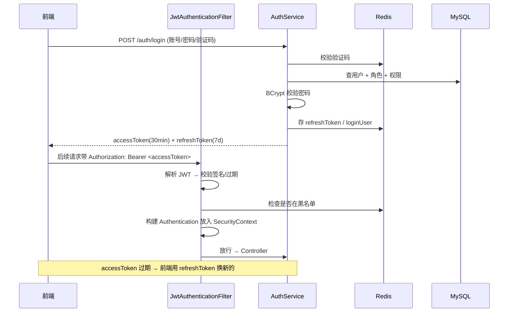

# 项目二 · 企业后台管理系统后端

> 阶段二（第 4–6 周）｜技术栈：Spring Boot 3.3 + MyBatis-Plus + MySQL 8 + Spring Security（W7 补齐）+ Redis（W7） + SpringDoc OpenAPI + EasyExcel + JUnit 5
>
> **目的**：产出**第一个像企业项目的东西** —— 这是简历上的主力项目，必须有规范的工程结构、完整的接口文档和可讲的设计。

---

## 1. 项目简介

一套通用的企业后台管理系统后端（类似 RuoYi / 若依的简化版，**但必须自己写一遍**）。提供用户、角色、菜单权限、部门、字典、操作日志、文件管理、定时任务等基础能力。

**为什么做这个**：后台管理系统是国内 Java 岗位最普遍的业务形态，RBAC 权限模型是必考设计题。这个项目做完，"权限表怎么设计"这类问题就有实际经验背书。

## 2. 技术栈

| 组件 | 版本 | 说明 |
|---|---|---|
| JDK | 17（或 21） | Spring Boot 3 最低要求 17 |
| Spring Boot | 3.3.x | Web / Validation / AOP / Cache |
| MyBatis-Plus | 3.5.x | 单表 CRUD 免写 SQL，复杂查询写 XML |
| MySQL | 8.0 | 持久化 |
| Druid / HikariCP | — | 连接池（Druid 带监控页，适合演示） |
| SpringDoc OpenAPI | 2.x | Swagger UI |
| Lombok + MapStruct | — | 样板代码与对象转换 |
| EasyExcel | 3.x | 导入导出 |
| JUnit 5 + Mockito | — | 单元测试 |
| Redis（W7 加） | 7.x | 缓存与 Token 存储 |

## 3. 包结构（企业级分层）

```
com.gagahaolihai.admin
├── AdminApplication.java
├── common/
│   ├── result/       Result<T>, ResultCode, PageResult<T>
│   ├── exception/    BusinessException, GlobalExceptionHandler
│   ├── constant/     Constants, CacheKeys
│   ├── enums/        StatusEnum, LogTypeEnum
│   └── annotation/   @Log, @RepeatSubmit
├── config/           WebMvcConfig, MybatisPlusConfig, SwaggerConfig, CorsConfig
├── security/         JwtFilter, SecurityConfig, LoginUser, UserDetailsServiceImpl
├── framework/
│   ├── aspect/       LogAspect, RepeatSubmitAspect
│   ├── interceptor/  AuthInterceptor
│   └── web/          BaseController
├── modules/
│   ├── system/       ├── controller/ service/ mapper/ entity/ dto/ vo/
│   ├── monitor/      操作日志、在线用户、定时任务
│   └── tool/         文件上传、代码生成（可选）
└── util/             JwtUtil, SecurityUtil, FileUtil, ExcelUtil
```

## 4. 功能清单

| 模块 | 功能 | 优先级 |
|---|---|---|
| 认证（W7 完整实现） | 登录 / 登出 / 刷新 Token / 获取用户信息 / 图形验证码 | P0 |
| 用户管理 | 增删改查、重置密码、启用禁用、分配角色、导入导出 Excel | P0 |
| 角色管理 | 增删改查、分配菜单权限、数据范围 | P0 |
| 菜单管理 | 树形增删改查、按钮级权限标识（`system:user:add`）、动态路由 | P0 |
| 部门管理 | 树形结构、层级查询 | P0 |
| 字典管理 | 字典类型 + 字典数据、前端下拉框数据源 | P1 |
| 操作日志 | AOP 注解自动记录、条件查询、详情查看 | P0 |
| 文件管理 | 上传（类型/大小校验）、下载、本地存储（后期换 MinIO） | P0 |
| 定时任务 | `@Scheduled` 示例（清理日志、统计报表） | P1 |
| 缓存 | 字典、菜单、权限注解式缓存（W7 加） | P1 |
| 接口限流 | 基于 Redis 的简单限流（W7 加） | P2 |

## 5. 数据库设计（RBAC 核心 5 张表 + 业务表）

```sql
-- 用户
CREATE TABLE sys_user (
  user_id     BIGINT       NOT NULL AUTO_INCREMENT,
  user_name   VARCHAR(30)  NOT NULL COMMENT '登录账号',
  nick_name   VARCHAR(30)  NOT NULL COMMENT '昵称',
  password    VARCHAR(100) NOT NULL COMMENT 'BCrypt 加密',
  email       VARCHAR(50),
  phone       VARCHAR(11),
  sex         CHAR(1)      DEFAULT '2' COMMENT '0男 1女 2未知',
  avatar      VARCHAR(255),
  dept_id     BIGINT,
  status      CHAR(1)      NOT NULL DEFAULT '0' COMMENT '0正常 1停用',
  del_flag    CHAR(1)      NOT NULL DEFAULT '0' COMMENT '0存在 2删除',
  login_ip    VARCHAR(128),
  login_date  DATETIME,
  create_by   VARCHAR(64),
  create_time DATETIME     DEFAULT CURRENT_TIMESTAMP,
  update_time DATETIME     DEFAULT CURRENT_TIMESTAMP ON UPDATE CURRENT_TIMESTAMP,
  remark      VARCHAR(500),
  PRIMARY KEY (user_id),
  UNIQUE KEY uk_user_name (user_name),
  KEY idx_dept (dept_id),
  KEY idx_status (status)
) ENGINE=InnoDB COMMENT='用户信息表';

-- 角色
CREATE TABLE sys_role (
  role_id     BIGINT      NOT NULL AUTO_INCREMENT,
  role_name   VARCHAR(30) NOT NULL,
  role_key    VARCHAR(100) NOT NULL COMMENT '权限字符 admin/common',
  role_sort   INT         NOT NULL DEFAULT 0,
  data_scope  CHAR(1)     NOT NULL DEFAULT '1' COMMENT '1全部 2自定义 3本部门 4本部门及以下 5仅本人',
  status      CHAR(1)     NOT NULL DEFAULT '0',
  del_flag    CHAR(1)     NOT NULL DEFAULT '0',
  create_time DATETIME    DEFAULT CURRENT_TIMESTAMP,
  update_time DATETIME    DEFAULT CURRENT_TIMESTAMP ON UPDATE CURRENT_TIMESTAMP,
  remark      VARCHAR(500),
  PRIMARY KEY (role_id),
  UNIQUE KEY uk_role_key (role_key)
) ENGINE=InnoDB COMMENT='角色信息表';

-- 菜单/权限（树形：目录 M / 菜单 C / 按钮 F）
CREATE TABLE sys_menu (
  menu_id     BIGINT       NOT NULL AUTO_INCREMENT,
  menu_name   VARCHAR(50)  NOT NULL,
  parent_id   BIGINT       NOT NULL DEFAULT 0,
  order_num   INT          NOT NULL DEFAULT 0,
  path        VARCHAR(200) COMMENT '路由地址',
  component   VARCHAR(255) COMMENT '前端组件路径',
  is_frame    TINYINT      DEFAULT 1,
  menu_type   CHAR(1)      NOT NULL COMMENT 'M目录 C菜单 F按钮',
  visible     CHAR(1)      DEFAULT '0',
  status      CHAR(1)      DEFAULT '0',
  perms       VARCHAR(100) COMMENT '权限标识 system:user:list',
  icon        VARCHAR(100),
  create_time DATETIME     DEFAULT CURRENT_TIMESTAMP,
  update_time DATETIME     DEFAULT CURRENT_TIMESTAMP ON UPDATE CURRENT_TIMESTAMP,
  PRIMARY KEY (menu_id),
  KEY idx_parent (parent_id)
) ENGINE=InnoDB COMMENT='菜单权限表';

-- 用户-角色
CREATE TABLE sys_user_role (
  user_id BIGINT NOT NULL,
  role_id BIGINT NOT NULL,
  PRIMARY KEY (user_id, role_id),
  KEY idx_role (role_id)
) ENGINE=InnoDB COMMENT='用户与角色关联表';

-- 角色-菜单
CREATE TABLE sys_role_menu (
  role_id BIGINT NOT NULL,
  menu_id BIGINT NOT NULL,
  PRIMARY KEY (role_id, menu_id),
  KEY idx_menu (menu_id)
) ENGINE=InnoDB COMMENT='角色与菜单关联表';

-- 部门（树形）
CREATE TABLE sys_dept (
  dept_id     BIGINT      NOT NULL AUTO_INCREMENT,
  parent_id   BIGINT      NOT NULL DEFAULT 0,
  ancestors   VARCHAR(50) NOT NULL DEFAULT '' COMMENT '祖级列表 0,1,2 便于查子孙',
  dept_name   VARCHAR(30) NOT NULL,
  order_num   INT         NOT NULL DEFAULT 0,
  leader      VARCHAR(20),
  phone       VARCHAR(11),
  status      CHAR(1)     NOT NULL DEFAULT '0',
  del_flag    CHAR(1)     NOT NULL DEFAULT '0',
  create_time DATETIME    DEFAULT CURRENT_TIMESTAMP,
  PRIMARY KEY (dept_id),
  KEY idx_parent (parent_id)
) ENGINE=InnoDB COMMENT='部门表';

-- 操作日志
CREATE TABLE sys_oper_log (
  oper_id        BIGINT       NOT NULL AUTO_INCREMENT,
  title          VARCHAR(50)  COMMENT '模块标题',
  business_type  INT          COMMENT '0其它 1新增 2修改 3删除',
  method         VARCHAR(200) COMMENT '方法名称',
  request_method VARCHAR(10),
  oper_name      VARCHAR(50),
  oper_url       VARCHAR(255),
  oper_ip        VARCHAR(128),
  oper_param     VARCHAR(2000),
  json_result    VARCHAR(2000),
  status         INT          COMMENT '0正常 1异常',
  error_msg      VARCHAR(2000),
  cost_time      BIGINT       COMMENT '耗时ms',
  oper_time      DATETIME     DEFAULT CURRENT_TIMESTAMP,
  PRIMARY KEY (oper_id),
  KEY idx_oper_time (oper_time),
  KEY idx_title (title)
) ENGINE=InnoDB COMMENT='操作日志记录';
```

### 设计要点（面试必答）

| 问题 | 参考答案要点 |
|---|---|
| 为什么用 5 张表做权限？ | 用户-角色-菜单三层解耦；多对多中间表让"一个用户多角色、一个角色多菜单"自然表达；按钮级权限靠 `menu_type='F'` + `perms` 字符串 |
| `ancestors` 字段干嘛的？ | 存祖级路径（`0,100,101`），查某部门下所有子孙用 `FIND_IN_SET` 或 `LIKE '%,101,%'`，避免递归查库 |
| 逻辑删除怎么实现？ | `del_flag`，MyBatis-Plus `@TableLogic` 自动加条件；注意唯一索引与逻辑删除冲突（`uk_user_name` 会挡住已删同名用户，解决方案：删除时改写 `user_name` 加后缀） |
| 权限怎么落到接口？ | `@PreAuthorize("@ss.hasPermi('system:user:add')")`，从 SecurityContext 取当前用户权限集合判断 |
| 数据权限怎么做？ | `data_scope` + MyBatis 拦截器自动拼 `AND dept_id IN (...)` |

## 6. 接口清单（节选，完整以 Swagger 为准）

| 方法 | 路径 | 说明 | 权限标识 |
|---|---|---|---|
| POST | `/api/v1/auth/login` | 登录，返回 accessToken + refreshToken | 匿名 |
| POST | `/api/v1/auth/refresh` | 刷新 Token | 匿名（带 refreshToken） |
| POST | `/api/v1/auth/logout` | 注销（Token 加黑名单） | 登录 |
| GET | `/api/v1/auth/me` | 当前用户信息 + 权限集合 + 菜单树 | 登录 |
| GET | `/api/v1/system/users` | 分页查询用户 | `system:user:list` |
| POST | `/api/v1/system/users` | 新增用户 | `system:user:add` |
| PUT | `/api/v1/system/users/{id}` | 修改用户 | `system:user:edit` |
| DELETE | `/api/v1/system/users/{ids}` | 批量删除 | `system:user:remove` |
| PUT | `/api/v1/system/users/{id}/password` | 重置密码 | `system:user:resetPwd` |
| GET | `/api/v1/system/roles` | 角色列表 | `system:role:list` |
| GET | `/api/v1/system/menus/tree` | 菜单树（角色授权用） | `system:menu:list` |
| POST | `/api/v1/system/menus` | 新增菜单 | `system:menu:add` |
| GET | `/api/v1/monitor/oper-logs` | 操作日志分页 | `monitor:operlog:list` |
| POST | `/api/v1/tool/upload` | 文件上传 | 登录 |

### 统一响应体

```json
{
  "code": 200,
  "msg": "操作成功",
  "data": { },
  "timestamp": 1767225600000,
  "traceId": "a1b2c3d4"
}
```

### 错误码约定

| code | 含义 |
|---|---|
| 200 | 成功 |
| 400 | 参数校验失败 |
| 401 | 未登录 / Token 失效 |
| 403 | 无权限 |
| 404 | 资源不存在 |
| 429 | 请求过于频繁 |
| 500 | 系统异常 |
| 1001+ | 业务异常（用户不存在、密码错误、角色已被分配不可删…） |

## 7. 核心流程：登录 + 鉴权（W7 完成后）



## 8. 非功能需求

- **接口规范**：RESTful 风格，统一响应体，统一异常，统一日志（含 traceId 链路）
- **性能**：列表接口在 10 万行数据下 P99 < 300ms（索引 + 分页优化后实测）
- **安全**：密码 BCrypt；接口全部鉴权（除白名单）；参数校验 `@Valid`；文件上传白名单校验；不提交任何密钥
- **可测试**：Service 层单测覆盖主要分支；提供 `.http` 冒烟脚本一键跑通主链路
- **代码量参考**：8000–12000 行

## 9. 验收清单

- [ ] 一键启动：建库 → 跑 `sql/schema.sql` + `sql/data.sql` → 改 `application-dev.yml` → `mvn spring-boot:run`
- [ ] Swagger 可访问，接口 ≥ 30 个且都能调通
- [ ] 统一响应 / 全局异常 / 参数校验 / 日志 traceId **四件套齐全**（面试常问）
- [ ] 数据库设计文档与脚本一致（字段、索引、注释）
- [ ] README 含 mermaid 架构图、模块说明、启动三步
- [ ] `mvn test` 全绿，Service 层主要分支有测试
- [ ] 有 `.http` 或 Postman 集合，能一键跑通"登录 → 查用户 → 新增用户 → 查日志"
- [ ] 操作日志能在页面上查到（含入参、出参、耗时）
- [ ] Excel 导入导出实测 1 万行不 OOM
- [ ] 打 Release `v2.0-stage2` 并写 Release Note

## 10. 面试自问自答

1. RBAC 表为什么这么设计？如果要支持"用户组"怎么扩展？
2. `@Transactional` 在这个项目里加在哪一层？为什么？
3. 统一异常处理会不会吞掉系统异常？怎么保证 500 也返回统一格式？
4. 逻辑删除和唯一索引冲突怎么解决？你项目里踩到了吗？
5. 一个用户有多个角色，权限是取并集还是交集？为什么？
6. 为什么选 MyBatis-Plus 而不是 JPA？各自适合什么场景？
7. 操作日志为什么用 AOP 而不是在每个方法里手写？
8. 接口幂等性你怎么保证的？（`@RepeatSubmit` + Redis）
9. 分页查询总数很慢怎么优化？（延迟关联 / 覆盖索引 / 估算总数）
10. 项目里最难的部分是什么？你怎么解决的？（**必须有真实答案**）
